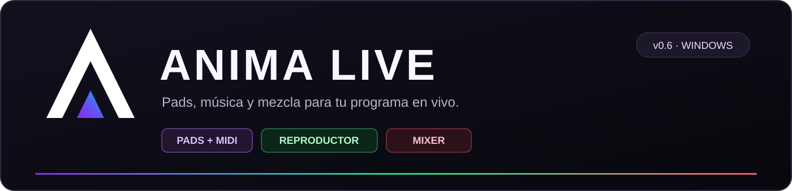
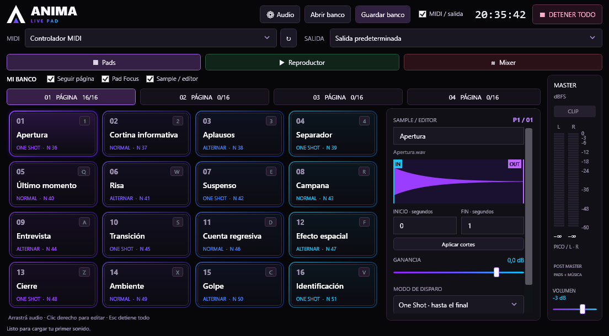
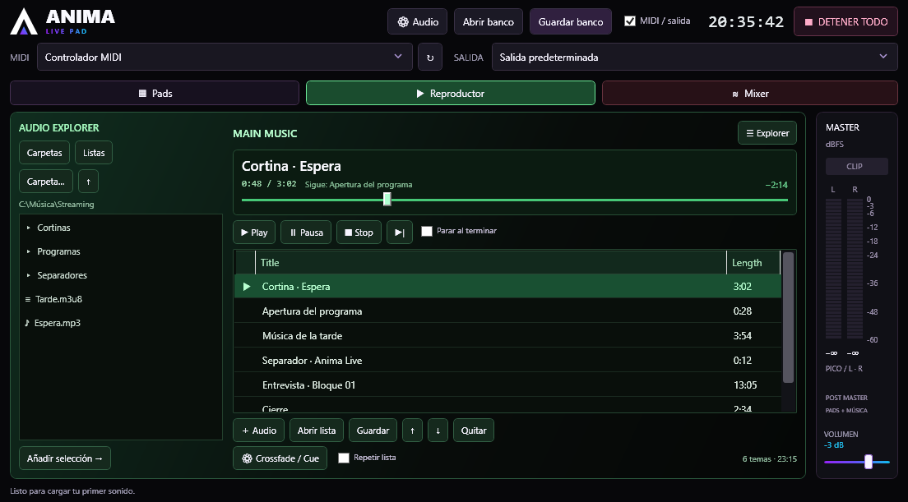
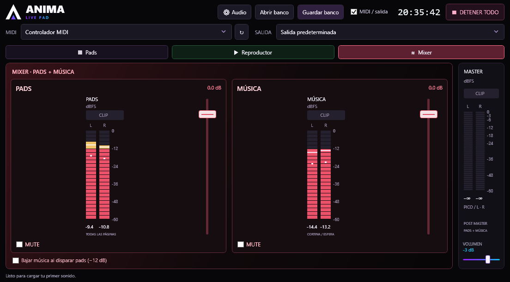
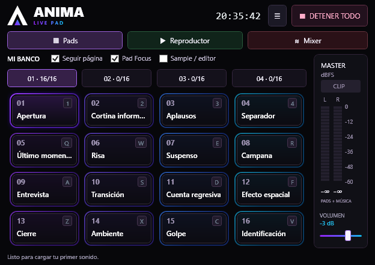
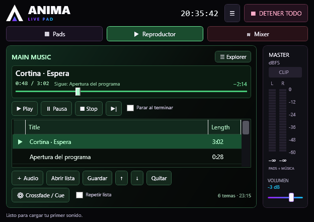
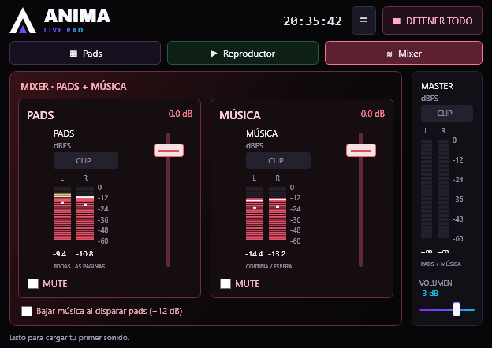

<p align="center">
  
</p>

<p align="center">
  <strong>Una botonera MIDI, un reproductor y un mixer en una app para Windows.</strong><br>
  Versión 0.6.0 · Windows x64 · C# / WPF · .NET 10
</p>

<p align="center">
  <a href="https://github.com/Marcosblancarg/anima-live/releases/tag/v0.6.0"><strong>Descargar para Windows</strong></a>
  · <a href="docs/uso.md">Guía de uso</a>
  · <a href="#compilar-desde-el-código">Compilar</a>
  · <a href="CHANGELOG.md">Novedades</a>
</p>

## Tu programa en vivo, en tres vistas

Anima Live reúne efectos, separadores, cortinas y música de espera. Dispará sonidos con el mouse, el teclado o un controlador como el **KORG nanoPAD2**; prepará la siguiente canción y ajustá la mezcla sin cortar lo que está sonando.

| Pads · violeta y cian | Reproductor · verde y negro | Mixer · rojo y negro |
|---|---|---|
| 64 sonidos en cuatro páginas, MIDI y editor de samples. | Audio Explorer, listas y cola Main Music con Title y Length. | Faders y vúmetros independientes para pads y música. |



<table>
  <tr>
    <td width="50%"></td>
    <td width="50%"></td>
  </tr>
</table>

Las capturas usan nombres y señales de ejemplo. La descarga viene sin biblioteca de audios.

## Qué hace

### Pads: tus sonidos a una pulsación

- **16 pads × 4 páginas:** nombres, seis colores, ganancia y asignación MIDI por pad.
- **Arrastrar y soltar:** cargá WAV o MP3 sobre un pad; varios archivos ocupan pads consecutivos.
- **Tres modos de disparo:** One Shot, Normal mientras mantenés pulsado y Alternar para iniciar/detener.
- **Sample / editor:** forma de onda, cortes IN/OUT y ganancia de −48 a +12 dB. Los cortes conservan el archivo original.
- **Pad Focus:** el MIDI selecciona e ilumina el pad que tocás, incluso si está vacío.
- **Aprendizaje MIDI:** notas y CC, canal, liberación y volumen por velocity opcional.
- **Bancos portables `.anima`:** guardan los 64 pads y sus audios; importación de bancos anteriores `.airepads`.
- Editor colapsable y bloqueo de edición para el vivo.

### Reproductor: prepará lo que sigue

- **Audio Explorer:** navegación por carpetas, archivos y listas recientes.
- **Main Music:** cola con título, duración, tema actual y siguiente, posición y tiempo restante.
- Play, pausa, stop, siguiente, búsqueda, reordenar y quitar temas.
- Repetición de lista, parada al terminar y **crossfade de 0, 1, 2, 3 o 5 segundos**.
- Importación **M3U, M3U8 y PLS**; exportación M3U8. Incluye listas antiguas en Windows-1252.
- Música desde disco con búfer limitado y precarga del próximo tema; admite archivos largos.
- **Preescucha / Cue** por una salida de Windows distinta de la emisión.

### Mixer: pads y música bajo control

- Dos canales con **fader de −60 a +6 dB**, MUTE y vúmetro estéreo de pico/RMS.
- Opción para **bajar la música 12 dB mientras suenan pads**, con transiciones suaves.
- **Master y vúmetro siempre visibles** a la derecha, con lectura L/R y aviso CLIP.
- Motor estéreo de 48 kHz, WASAPI compartido y ajustes de búfer y sincronización.
- **DETENER TODO / Esc** corta pads, música y preescucha.

### Una ventana que se adapta

Las pestañas de arriba cambian de vista sin interrumpir el audio. El MIDI funciona en las tres. El reloj muestra la hora local de Windows.

La ventana inicia en **1120 × 650**, cabe en pantallas de **1366 × 768** y se puede reducir hasta **640 × 480**. Los controles se reorganizan al cambiar el tamaño y se recuerda la última medida.

<details>
<summary><strong>Ver las tres vistas compactas</strong></summary>





</details>

## Empezar a usarla

1. Descargá el ZIP de [Anima Live 0.6.0](https://github.com/Marcosblancarg/anima-live/releases/tag/v0.6.0) y extraelo completo en una carpeta donde puedas guardar archivos.
2. Abrí **`AnimaLivePad-v06/app/AnimaLivePad.exe`**. Incluye el runtime: no necesitás instalar .NET para usarla.
3. Elegí **SALIDA** y, si lo usás, el controlador **MIDI**.
4. En **Pads**, arrastrá un audio a un cuadrado. Clic para disparar; clic derecho para editar.
5. En **Reproductor**, elegí una carpeta o usá **＋ Audio**, armá la cola y pulsá Play.
6. En **Mixer**, ajustá Pads y Música. Guardá tu banco de pads y tu lista musical.

La app funciona localmente, sin conexión a Internet. La configuración y la cola se recuerdan al cerrar; la música queda detenida al volver a abrir. Los bancos de pads se guardan manualmente.

### Atajos principales

| Acción | Atajo |
|---|---|
| Pads / Reproductor / Mixer | F5 / F6 / F7 |
| Páginas de pads 1–4 | F1–F4 |
| Disparar las cuatro filas de pads | `1 2 3 4` · `Q W E R` · `A S D F` · `Z X C V` |
| Pausar / reanudar música en Reproductor | Espacio |
| Detener toda la reproducción | Esc |

Los atajos de disparo de pads funcionan en la vista Pads y se suspenden mientras escribís en un campo.

## MIDI y nanoPAD2

Seleccioná un pad, pulsá **Aprender** y tocá su botón físico. Repetí la asignación para cada página y guardá el banco.

Para distinguir las cuatro escenas del nanoPAD2, configurá **notas o canales diferentes por escena**. Con **Seguir página por MIDI**, Anima Live muestra la página correspondiente al tocar un pad asignado. El botón SCENE por sí solo no sincroniza la pantalla. El modo Normal necesita Note Off, Note On con velocity cero o un CC momentáneo.

La [guía de uso](docs/uso.md#controladores-midi-y-cuatro-páginas) explica el mapeo, los mensajes compartidos y Pad Focus.

## Compilar desde el código

Necesitás **Windows y el SDK de .NET 10**. El proyecto usa WPF y NAudio 2.2.1.

```powershell
git clone https://github.com/Marcosblancarg/anima-live.git
cd anima-live
dotnet build src/AnimaLive/AnimaLive.csproj -c Release
```

Para generar el ejecutable x64 con el runtime incluido y ejecutar las pruebas sin abrir dispositivos:

```powershell
.\scripts\build.ps1 -Test
```

El resultado queda en **`artifacts/windows-x64/AnimaLivePad.exe`**. También podés abrir `src/AnimaLive/AnimaLive.csproj` en un IDE compatible con .NET 10.

## Documentación y código

| Recurso | Contenido |
|---|---|
| [Guía de uso](docs/uso.md) | Pads, MIDI, cortes, bancos, listas, preescucha, mixer y audio. |
| [Arquitectura](docs/arquitectura.md) | Interfaz, buses de audio, streaming, persistencia y mapa del código. |
| [Verificación](docs/pruebas.md) | Pruebas automáticas, salida virtual y alcance de las comprobaciones. |
| [Changelog](CHANGELOG.md) | Cambios hasta la versión 0.6. |
| [`src/AnimaLive`](src/AnimaLive) | Proyecto C# / WPF completo y pruebas integradas. |

Las pruebas incluidas cubren audio, modos de disparo, MIDI, bancos, listas, streaming, crossfade, mixer y tamaños de ventana. Ver [resultados y método](docs/pruebas.md).

## Alcance de la 0.6 y próximos pasos

La 0.6 incorpora la reproducción musical como primer paso hacia una app de continuidad para radio y streaming.

- Los pads tienen una voz por pad y no incluyen bucle; la música puede repetir la lista.
- WAV y MP3 están probados; otros formatos dependen de los decodificadores disponibles en Windows/NAudio.
- Las listas musicales referencian archivos locales. Los bancos `.anima` sí incluyen los audios.
- La preescucha requiere otra salida o par de canales visible en Windows.
- Los medidores muestran picos de muestras y RMS; no calculan LUFS ni true peak.
- No incluye EQ, filtros, ASIO ni salidas independientes por pad.

La evolución prevista incluye programación horaria, tandas, rotaciones y herramientas de continuidad. Su alcance y fechas se definirán para las próximas versiones. La validación prolongada en el equipo de emisión y el ruteo físico de la Audient iD24 siguen pendientes.

## Créditos y licencias de dependencias

Anima Live usa **NAudio 2.2.1** y **.NET 10**. Las licencias y avisos de terceros están en [`licenses/`](licenses). El repositorio se mantiene privado; esta publicación no añade una licencia de código abierto al código propio de Anima Live.
